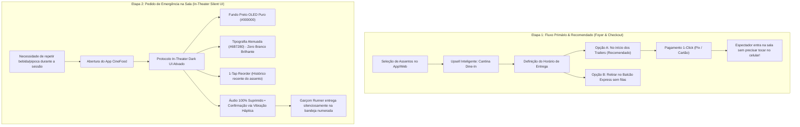

# Estudo de Branding, Identidade Visual & Design de Produto: Benchmarking Global de Redes Cinematográficas e Plataformas Dine-In

**Projeto:** CineFood (Multiplex & Gastronomia na Poltrona)  
**Data:** 07 de Novembro de 2026  
**Status:** Consolidado via Exploração Ativa de Mercado e Diretrizes de Engenharia  

---

## 1. Contexto & Objetivos da Investigação

A experiência do cinema contemporâneo transcendeu a simples exibição de projeção e áudio. Em mercados de alta maturidade (EUA, Reino Unido e Coreia do Sul), a convergência entre **cinema premium** e **gastronomia de alta hospitalidade (Dine-In)** tornou-se a âncora de fidelização e a maior alavanca de Ticket Médio por espectador.

Para consolidar a identidade do **CineFood** com rigor estético, sem clichês visuais (*zero AI slop*, sem gradientes roxos saturados ou glassmorphism genérico) e com estrita conformidade de acessibilidade (WCAG 2.2 AA), realizamos uma análise profunda dos líderes globais em identidade de cinema e hospitalidade de sala:
1. **Alamo Drafthouse Cinema** (Pioneiro do modelo Dine-In e cultura cinéfila nos EUA)
2. **Everyman Cinemas** (Líder em hospitalidade boutique e sofisticação no Reino Unido)
3. **Curzon Cinema & Arthouse** (Aclamado rebrand de prestígio editorial pela agência *The Plant*)
4. **Nitehawk Cinema** (Pioneiro independente do Brooklyn em jantares na poltrona e coquetelaria)
5. **Letterboxd & Apple TV** (O padrão-ouro em interfaces de descoberta e escaneabilidade escura)

---

## 2. Anatomia de Marca dos Concorrentes Globais

| Rede / Plataforma | Filosofia Estética & Identidade | Cores de Marca & Acentos | Tipografia Característica | Paradigma Dine-In / Operacional |
| :--- | :--- | :--- | :--- | :--- |
| **Alamo Drafthouse** *(EUA)* | *"Mid-Century meets Punk"*; visual DIY analógico, homenagem a pôsteres vintage e letreiros clássicos *marquee*. | Preto e Branco absolutos com acento primário **PMS 7409 ("Schoolbus Yellow" / Âmbar Quente `#FDB813`)**. | **Futura Std Bold** (títulos em caixa alta, preços e cardápio) + **Adobe Garamond Pro** (sinopses e notas curatoriais). | Serviço de mesa na poltrona. Passou por polêmica recente ao forçar app em sala escura (*O Paradoxo de Alamo*). |
| **Everyman Cinema** *(UK)* | *"Golden Age of Cinema meets Modern Luxury"*; atmosfera de clube de hospitalidade, sofás de veludo, iluminação quente e acolhedora. | Carvões profundos, azuis-noite, madeiras nobres com acentos em **latão quente, cobre e dourado vintage**. | Tipografia geométrica contemporânea combinada com *headers* de corte clássico de letreiro cinematográfico. | Cozinha proprietária (*Spielburger*), pizzas artesanais e vinhos servidos diretamente nos sofás da sala. |
| **Curzon** *(UK)* | Prestígio editorial e curadoria arthouse (*Rebrand The Plant*); atmosfera atmosférica com feixes de luz cortando a penumbra. | Tons terrosos, ferrugem, verde-oliva escuro, detalhes em latão e base escura de alto contraste para filmes. | Grotesque refinada com alto peso e micro-dados nítidos. Foco em *"Great copy, not just great typography"*. | Bares de lounge integrados, seleção de vinhos e bomboniere premium artesanal. |
| **Nitehawk Cinema** *(NYC)* | Nostalgia de palácio de cinema do Brooklyn com elegância noturna contemporânea e metais industriais. | Preto fosco, detalhes em neon retro e acentos quentes de lâmpadas incandescentes. | Tipografia geométrica e angulada (*Nitehawk wordmark*), com estética *nocturnal marquee*. | Mesas integradas entre poltronas com iluminação indireta inferior de baixa intensidade e cardápios temáticos por filme. |
| **Letterboxd** *(Global)* | Minimalismo funcional para cinéfilos; arte do filme em primeiro lugar com metadados cristalinos. | Canvas neutro escuro `#14181C`, acento primário **Cine Green `#00E054`** (contraste 9.8:1) e estrelas amarelas. | Sans-serif moderna, compacta e de alta densidade informativa. | Padrão poster-first com proporção estrita 2:3 e bordas *keyline* sutis para não sangrar no fundo escuro. |

---

## 3. O "Paradoxo de Alamo" e a Solução Arquitetural do CineFood

### 3.1 A Lição Operacional e Crítica Pública da Alamo Drafthouse
A Alamo Drafthouse sempre foi reverenciada por sua política estrita de *"No Talking, No Texting"*, expulsando qualquer cliente que acendesse a tela do celular durante o filme. Contudo, em 2023–2024, para otimizar custos com garçons e agilizar o fechamento de contas, a rede introduziu o pedido via QR Code no celular durante o filme.

O resultado foi uma intensa crise de percepção (*The Irony Paradox*), recebendo críticas duras da comunidade cinéfila e de figuras públicas (como o ator Elijah Wood):
> *"A rede que nos ensinou a odiar telas de celular acesas no cinema agora nos obriga a acender o celular no meio do filme para pedir cerveja ou pagar a conta."*

Além disso, a dispersão de luz branca de celulares comuns em telas OLED e o desvio de atenção prejudicaram a imersão de toda a plateia.

### 3.2 Como o CineFood Resolve Definitivamente Esse Conflito
O CineFood estabelece uma separação arquitetural em duas etapas funcionais:



---

## 4. O Sistema de Identidade e Design Tokens do CineFood

A identidade do CineFood combina a **dignidade cinematográfica** (preto e vermelho de projeção) com a **calidez gastronômica** (âmbar culinário do milho da pipoca e latão quente de lounges) e a **precisão transacional** (verde de alto contraste Letterboxd).

### 4.1 A Tríade Cromática Funcional
1. **Verde Ação Primária (`#00E054`):**
   - Inspirado no ecossistema Letterboxd.
   - Fornece razão de contraste de **`9.8:1`** sobre o fundo `#0D0E12`, superando com folga o padrão WCAG 2.2 AAA (7:1).
   - Utilizado em: confirmação de poltronas selecionadas, avançar no checkout e badges de status positivo.
2. **Âmbar Culinário / Latão Marquee (`#F59E0B` / `#D97706`):**
   - Homenagem ao tom **PMS 7409** da Alamo Drafthouse e aos interiores quentes da Everyman.
   - Evoca a pipoca artesanal na manteiga clarificada, cervejas artesanais e as lâmpadas incandescentes dos letreiros clássicos.
   - Utilizado em: cantina Dine-In, botões de adicionar ao carrinho gastronômico, tags de classificação indicativa (12/14 anos) e destaques de cardápio.
3. **Vermelho Cinema (`#E50914`):**
   - Herança cinematográfica tradicional e marca institucional.
   - Utilizado em: salas IMAX/Dolby, avisos críticos e logotipo do CineFood.
4. **Azul Acessibilidade Internacional (`#2563EB`):**
   - Conformidade estrita WCAG 2.2 AA.
   - Exclusivo para assentos PCD (Cadeirante ♿, Mobilidade Reduzida, Obeso 1.5× e Acompanhante).

### 4.2 Arquitetura de Fundo e Superfícies (HSL Elevation)
```
[Canvas Geral]       #0D0E12  • HSL(225, 19%, 6%)  - Evita halamento visual em telas escuras
[Superfície Nível 1] #16181F  • HSL(225, 17%, 10%) - Cards de filmes e seções principais
[Superfície Nível 2] #202430  • HSL(225, 20%, 16%) - Modais, bottom-sheets e menus suspensos
[Superfície Nível 3] #2A3040  • HSL(225, 21%, 21%) - Destaques, hover e tooltips
[Bordas e Divisores] #2B303C  • HSL(218, 17%, 20%) - Linhas de contenção nítidas e sutis
[In-Theater Mode]    #000000  • OLED Absoluto       - Zero emissão de fótons nas bordas
```

---

## 5. Engenharia Gastronômica: O Cardápio "Silent Dining"

Inspirado no modelo Everyman (*Spielburger*) e Nitehawk, os produtos do CineFood são especificamente projetados para **consumo em sala de cinema**, minimizando qualquer distração sonora ou olfativa desagradável:

1. **Cozinha Artesanal na Poltrona (Finger Food Silencioso):**
   - *Mini Smash Burgers em Pão Brioche Macio:* Sem embalagens laminadas crocantes; servidos em caixas aveludadas de abertura suave.
   - *Crispy Hot Honey Chicken Bites:* Frango empanado sem ossos, tamanho mordida com molho de mel picante.
   - *Pizzas Artesanais em Fatias Pré-cortadas:* Fermentação natural, massa leve e servidas em suportes rígidos.
2. **Pipocas Gourmet de Autor:**
   - *Trufada com Parmesão Reggiano:* Azeite de trufa branca e parmesão ralado fino.
   - *Caramelo Salgado & Flor de Sal de Guérande:* Crocância equilibrada que não empedra.
   - *Manteiga Clarificada Ghee & Sal Rosa:* A versão clássica definitiva, servida em baldes térmicos reciclados anti-vazamento.
3. **Bar & Coquetelaria Silenciosa (Anti-Clinking):**
   - Copos térmicos com parede dupla revestida de silicone interno: eliminam o barulho de pedras de gelo batendo no vidro durante cenas silenciosas do filme.
   - Seleção de vinhos em taças de policarbonato fosco de toque aveludado e cervejas artesanais servidas na temperatura exata.

---

## 6. Próximos Passos & Integração

1. **Tokens Sincronizados:** O arquivo `cinefood/src/design-tokens.json` foi enriquecido com a nova paleta de acento culinário (`culinary-amber`), tipografias e pesos.
2. **Protótipo Interativo Elevado:** As melhorias estéticas e funcionais de cardápio, timing de entrega e protocolo In-Theater estão refletidas no protótipo executável em `cinefood/docs/prototipo/index.html`.
3. **Figma Design System:** O canvas do Figma (`4BTQA3NO0k6yi4659FHdVJ`) receberá os novos componentes refinados de cartões gastronômicos e seletor de entrega.
